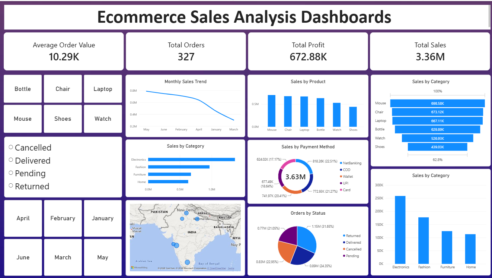

# Ecommerce Sales Analysis Dashboard

An end-to-end sales analytics project that turns raw ecommerce order data into an interactive Power BI dashboard. Data is cleaned with Python, stored and queried in PostgreSQL, and modeled with DAX.



## Overview

This project analyzes ecommerce orders to understand sales performance, profitability, customer payment behavior and order fulfillment.

| Metric | Value |
|---|---|
| Total Orders | 327 |
| Total Sales | 3.36M |
| Total Profit | 672.88K |
| Average Order Value | 10.29K |

## Tech Stack

- **Python** (Pandas, NumPy) for data cleaning and transformation
- **Excel** for initial data inspection and validation
- **PostgreSQL** for data storage and SQL aggregation
- **Power BI** for dashboard design
- **DAX** for measures and calculated columns

## Workflow

1. **Data cleaning:** Removed duplicates, handled missing values and standardized data types using Pandas and NumPy.
2. **Data storage:** Loaded the cleaned dataset into PostgreSQL.
3. **Querying:** Wrote SQL queries to aggregate sales by product, category, payment method, order status and region.
4. **Modeling:** Created DAX measures for total sales, total profit, total orders and average order value.
5. **Visualization:** Built an interactive Power BI dashboard with slicers and cross-filtering.

## Dashboard Features

- KPI cards: Average Order Value, Total Orders, Total Profit, Total Sales
- Monthly sales trend
- Sales by product and by category
- Sales by payment method (NetBanking, COD, Wallet, UPI, Card)
- Orders by status (Delivered, Pending, Cancelled, Returned)
- Geographic map of sales by location
- Slicers for product, month and order status

## Key Insights

> Replace these with your own findings.

- Which category generated the most sales (for example, Electronics led with X% of total sales)
- The most-used payment method and its share of sales
- The share of orders that were cancelled or returned
- The trend in monthly sales and what may explain it

## Project Structure

```
ecommerce-sales-analysis/
├── data/
│   ├── raw_orders.csv
│   └── cleaned_orders.csv
├── notebooks/
│   └── data_cleaning.ipynb
├── sql/
│   └── analysis_queries.sql
├── dashboard/
│   └── ecommerce_sales_dashboard.pbix
├── images/
│   └── dashboard.png
└── README.md
```

Adjust the folder names to match your repository.

## How to Run

1. Clone the repository:
   ```bash
   git clone https://github.com/<your-username>/ecommerce-sales-analysis.git
   cd ecommerce-sales-analysis
   ```
2. Install the Python dependencies:
   ```bash
   pip install pandas numpy
   ```
3. Run the cleaning notebook or script to generate `cleaned_orders.csv`.
4. Create a PostgreSQL database, load the cleaned data and run the queries in `sql/analysis_queries.sql`.
5. Open the `.pbix` file in Power BI Desktop and refresh the data source.

## Author

**NIKHIL SHARMA**
[LinkedIn](www.linkedin.com/in/collegex) | [GitHub](https://github.com/nikhil-collegex)
